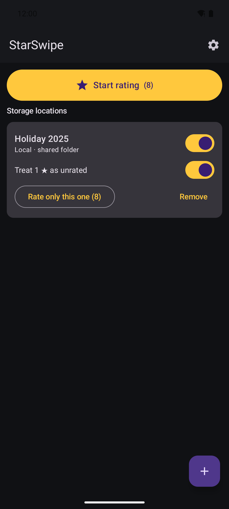
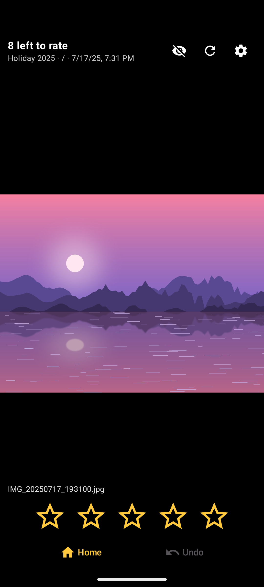
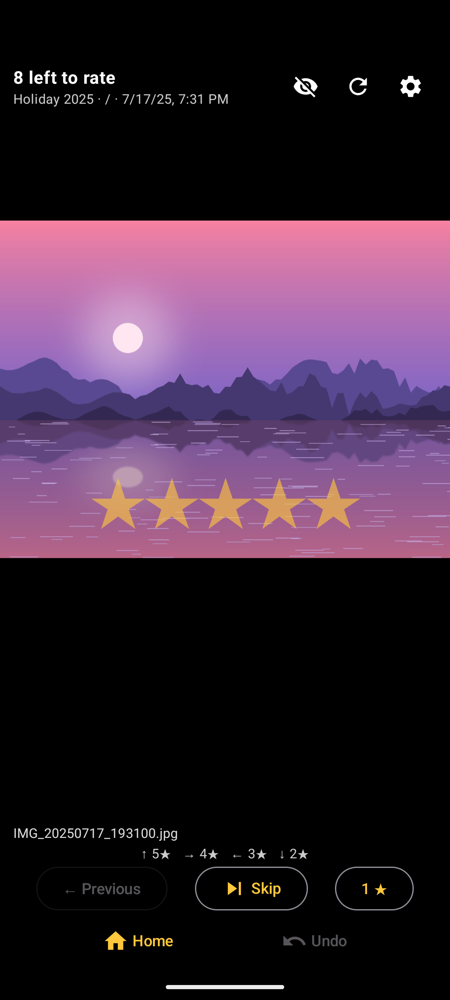
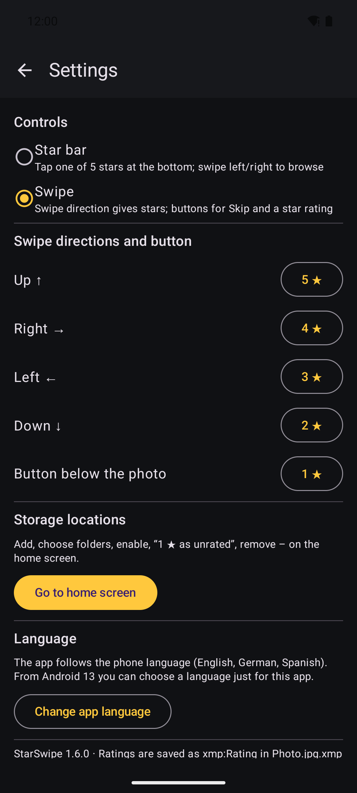

# StarSwipe


Android app for rating photos with stars by swiping. The rating is written as `xmp:Rating` into a sidecar
file (`photo.jpg.xmp`) next to the photo; the original files are never changed. darktable, digiKam and
other programs read these ratings directly.

Photos can live on **Nextcloud**, **WebDAV**, **SMB** shares (e.g. a NAS) or in **folders on the phone**.

<p>




</p>

## Features

- Star bar (tap 1–5 stars) or swipe mode (each direction gives a star value you choose, plus a button)
- Undo, skip, hide rated photos, treat 1 ★ as unrated
- Ratings made offline are written later; reading folders continues in the background
- English, German and Spanish
- No ads, no tracking, no account with us – the app only talks to your own storage

## Building

Requirements: JDK 17 and the Android SDK (platform 35).

```
./gradlew assembleRelease      # unsigned APK in app/build/outputs/apk/release/
./gradlew testDebugUnitTest    # unit tests (Robolectric)
```

The SMB integration test only runs when the `SMB_TEST_*` environment variables point to a test share.

## Translations

Texts live in `app/src/main/res/values*/strings.xml` (`values` = English). `TranslationsTest` checks that
every language has all strings with the same placeholders. Store texts are in `fastlane/metadata/android/`.

## About

Developed by Jan Borghoff. The app was developed largely with the help of AI (Claude by Anthropic, via Claude Code).

## License

Copyright (C) 2026 Jan Borghoff

This program is free software: you can redistribute it and/or modify it under the terms of the GNU General
Public License, version 3, as published by the Free Software Foundation. It is distributed without any
warranty. See [LICENSE](LICENSE) for the full text.

Libraries used (AndroidX, Jetpack Compose, OkHttp, Coil, smbj, kotlinx) are licensed under Apache-2.0.
